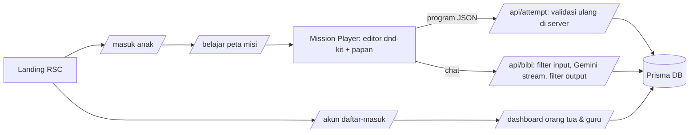

# Rencana Implementasi CodeKids (berdasarkan PRD.md)

## 1. Hasil Analisis Project
- Folder `e:\codekids` **hanya berisi `PRD.md`**: belum ada kode, `package.json`, atau git.
- Jadi **semua fitur PRD belum diimplementasikan**, dan tidak ada fitur lama yang berisiko rusak.
- Lingkungan: Node 24.12, npm 11.6 (harus lewat `npm.cmd` karena PowerShell memblokir `npm.ps1`), registry npm bisa diakses.

## 2. Dependency yang Dipakai dan Kegunaannya

| Dependency | Kegunaan | Dasar di PRD |
| --- | --- | --- |
| `next`, `react`, `react-dom` | Framework App Router (RSC untuk landing, Client Component untuk editor dan chat) | Tech stack §4.6 |
| `tailwindcss` v4 + `@tailwindcss/postcss` | Styling + *design tokens* (peach/dongker/oranye) via `@theme` (pengganti `tailwind.config` di v4) | §4.6, NFR-UX-01 |
| `typescript` (dikunci ke v5) | Tipe statis; v7 belum aman untuk Next | Pemeliharaan §5.5 |
| `@google/genai` | SDK resmi Gemini (streaming, *safety settings*, *system instruction*), **hanya dipakai di server** | FR-AI-*, FR-AI-S5 |
| `@dnd-kit/core`, `@dnd-kit/sortable`, `@dnd-kit/utilities` | Drag-and-drop yang mendukung **sentuh + mouse + keyboard** | FR-MISI-04, NFR-UX-06 |
| `prisma` + `@prisma/client` (v6) | ORM relasional. Lokal memakai SQLite (tanpa server DB); untuk produksi cukup ganti `provider` ke PostgreSQL/Supabase | §4.6 Data |
| `bcryptjs` | Hash kata sandi orang tua/guru dan PIN anak | NFR-SC-03 |
| `jose` | Menandatangani JWT sesi di cookie httpOnly (bisa dipakai di Proxy/Edge) | NFR-SC-03 |
| `zod` | Validasi input form/API dan skema JSON konten misi | FR-MISI-12, keamanan |
| `vitest` (dev) | Unit test untuk logika validasi misi, penilaian bintang, dan guardrail AI | §5.5, FR-AI-S7 |

> Tanpa library chart: grafik aktivitas dibuat dengan SVG sendiri. Tanpa aset audio: suara perayaan dibuat lewat Web Audio API. TTS memakai Web Speech API bawaan browser.

## 3. Arsitektur

- **Mesin misi (`src/lib/engine`)**: interpreter murni TypeScript dengan program AST (`aksi`, `ulangi N`, `jika…maka…lainnya`), dipakai di klien (animasi) **dan** di server (validasi anti-curang). Ada 4 jenis papan:
  - `grid`: karakter bergerak (maju, belok, ambil, siram, lompat, petik) dengan sensor kondisi
  - `numberline`: tambah/kurang menuju target (perkalian sebagai penjumlahan berulang)
  - `sort`: IF-ELSE dijalankan pada setiap benda (genap/ganjil, terapung/tenggelam, herbivora)
  - `sequence`: menyusun urutan kartu (siklus air, tumbuh kembang tanaman, penjumlahan bersusun)
- **Konten misi**: `src/content/missions/level-{1,2,3}.json`, divalidasi zod, dengan 5 misi per level (total 15), petunjuk bertingkat buatan manual, dan jumlah blok optimal.
- **Penilaian**: bintang 1–3 dari efisiensi blok, percobaan gagal, dan tingkat petunjuk. Skor/XP → pangkat (Penjelajah → Petualang → Jagoan Kode). Lencana: Misi Pertama, Tanpa Petunjuk, Bintang Tiga, Master Sequencing/Looping/Kondisional. Level terbuka bila ≥ 70% bintang level sebelumnya terkumpul.

## 4. Model Data (Prisma)
`User` (PARENT/TEACHER, email, hash, familyCode) · `ChildProfile` (nama panggilan, avatar, kelas 1–6, hash PIN, persetujuan, batas waktu harian, penguncian PIN) · `Class` (kode kelas, guru) · `Attempt` · `Progress` (bintang/skor terbaik, percobaan, petunjuk) · `Badge` · `ChatLog` (pesan tersamarkan, tingkat petunjuk, rating 👍/👎) · `ActivityDay` (detik belajar per hari).

## 5. Auth & Peran
- Orang tua/guru: email + kata sandi (bcrypt), sesi JWT httpOnly `ck_adult`.
- Anak: **tanpa email**. Masuk lewat **Kode Keluarga** atau **Kode Kelas** → pilih avatar → PIN 4 digit (terkunci 5 menit setelah 5 kali salah). Sesi terpisah `ck_child`, sehingga area anak dan dewasa terpisah (NFR-UX-07).
- RBAC: orang tua hanya bisa mengakses anaknya sendiri, guru hanya siswa di kelasnya. Route Handler memeriksa `Origin` (CSRF); Server Action sudah dilindungi Next.

## 6. Tanya Bibi AI
- `POST /api/bibi` (server-only): rate limit per anak per misi → filter input (samarkan PII, deteksi *prompt injection*/kata kasar) → tentukan tingkat petunjuk (1 pertanyaan pemandu, 2 analogi, 3 petunjuk spesifik dari **diagnosis program** hasil mesin) → Gemini stream (safety `BLOCK_LOW_AND_ABOVE`) → filter output per kalimat (kebocoran solusi, PII, topik) → stream ke klien → disimpan ke `ChatLog` → memengaruhi bintang.
- Tanpa `GEMINI_API_KEY`: **mode offline** memakai petunjuk bertingkat dari JSON misi, jadi demo tetap jalan. Jika API gagal: pesan fallback dari PRD.
- Panel chat berada di samping papan (desktop) atau di bawah papan (tablet/ponsel), dilengkapi tombol pertanyaan cepat, 🔊 TTS, dan 👍/👎.

## 7. Dashboard
- **Orang tua**: kartu anak, ringkasan (bintang, skor, level, pangkat, waktu mingguan), progres per misi, peta penguasaan konsep, grafik 14 hari, riwayat Bibi + ringkasan topik, rekomendasi aktivitas rumah, pengaturan (batas waktu, reset PIN, ekspor JSON, hapus data), gabung ke kelas.
- **Guru**: buat kelas + kode/tautan undangan, tabel siswa yang bisa diurutkan dan disaring, penanda "tidak aktif"/"butuh bantuan", detail siswa, reset PIN, ekspor CSV.

## 8. Tahapan
1. Scaffold Next.js + Tailwind + tokens + font (Baloo 2/Nunito).
2. Mesin misi + 15 misi JSON + unit test.
3. Prisma schema + seed demo + auth (dewasa & anak) + Proxy route guard.
4. Area anak: masuk, onboarding Bibi, peta misi, mission player (dnd-kit + tap-to-add), perayaan, simpan progres.
5. Tanya Bibi AI + guardrail + test red-team.
6. Dashboard orang tua & guru.
7. Landing page + demo `/coba` + halaman privasi.
8. `lint`, `test`, `build`, lalu uji jalan (smoke test) dan perbaiki error.

## 9. Batasan yang Disadari (dicatat, bukan dipalsukan)
- Verifikasi email dan login Google butuh layanan email/OAuth eksternal, jadi belum diaktifkan pada MVP lokal.
- Sentry/PostHog belum dipasang; titik integrasinya didokumentasikan.
